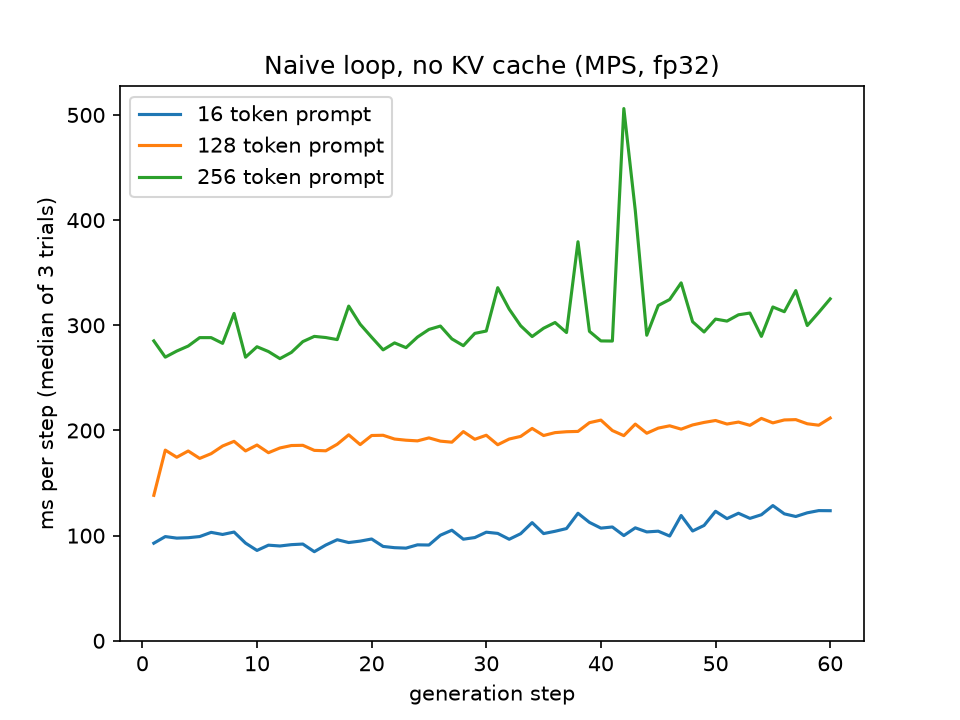

# MiniServe

A small LLM inference engine built from scratch, one stage at a time.
Model: Qwen2.5-0.5B-Instruct. Hugging Face is used for the forward pass only.

## Status

Stage 1 of 6 done: naive generation loop (no KV cache).

## Stage 1 results

M1 Mac, MPS, fp32, 60 new tokens, 3 trials, median ms per step
(steps 2-11 vs last 10):

| Prompt length | Early | Late |
|---|---|---|
| 16 tokens | 98 | 122 |
| 128 tokens | 181 | 209 |
| 256 tokens | 286 | 313 |



Without a KV cache, every step recomputes the whole sequence, so longer
prompts make every step slower, and steps slow down as the output grows.
One trial stalled for over a minute around step 43 (probably memory
pressure on 8 GB), so medians are reported. Raw data:
results/stage1_naive_mps_fp32.json

## Run

```bash
pip install -r requirements.txt
PYTHONPATH=src python -m miniserve.hf_baseline
PYTHONPATH=src python -m miniserve.stage1_results
PYTHONPATH=src python -m pytest tests/test_stage1.py -s -v
```

## Correctness

tests/test_stage1.py compares greedy output with model.generate() on 5 prompts,
40 new tokens each, on CPU in fp32 (token ids must match exactly).
The timing results above were measured on MPS, not CPU.
Not tested yet: sampling with temperature, top-k or top-p, long prompts,
stopping at the end token.

Next: KV cache.
